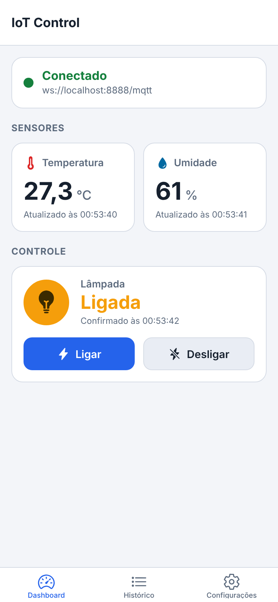
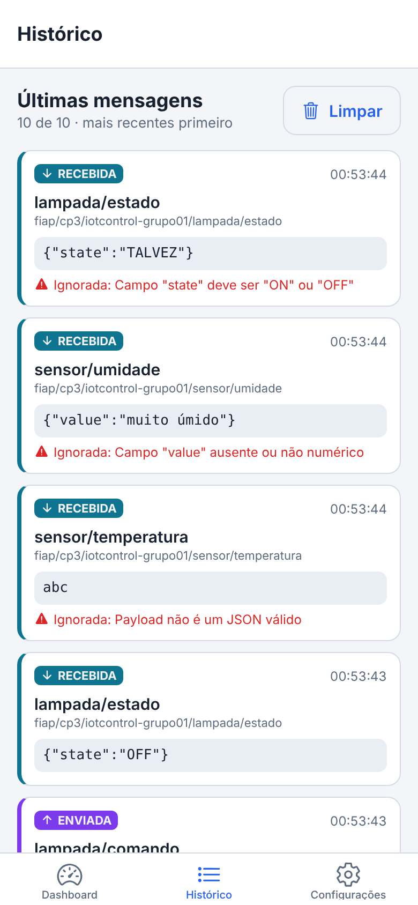
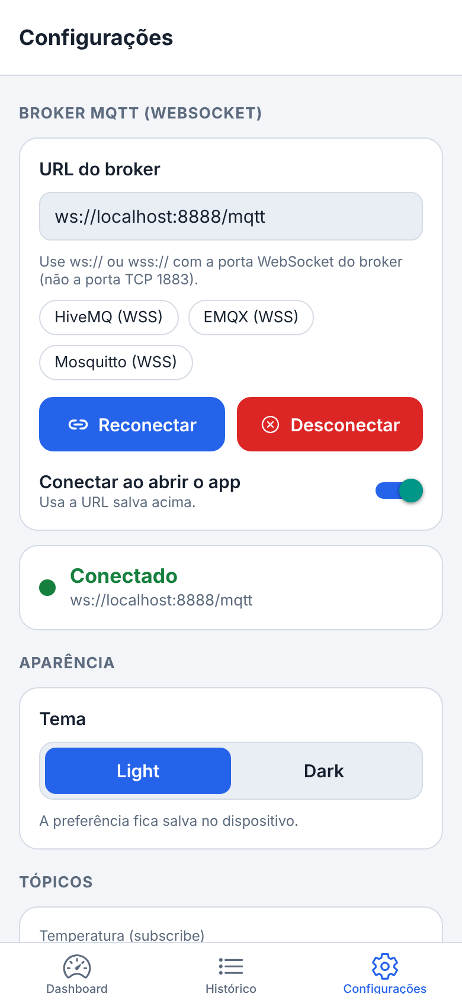
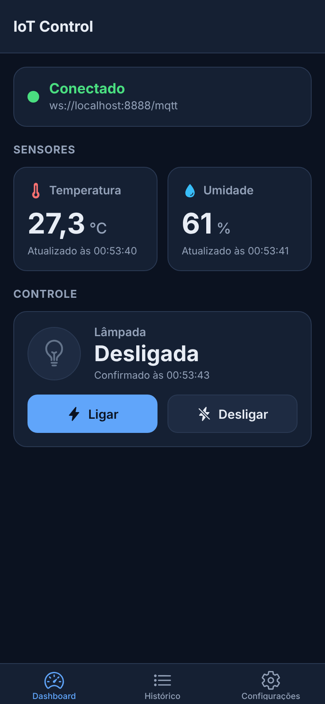
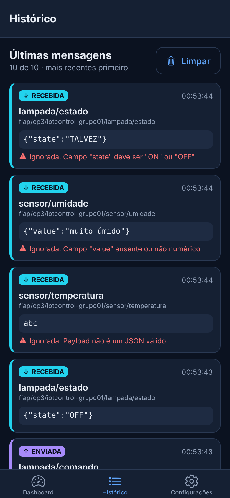
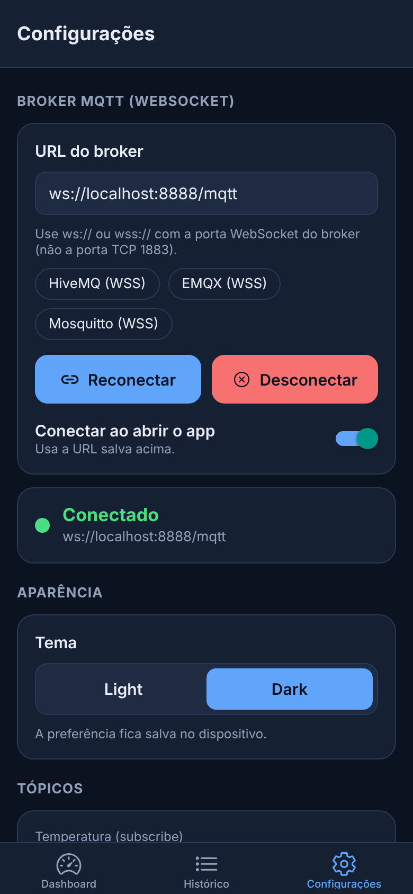
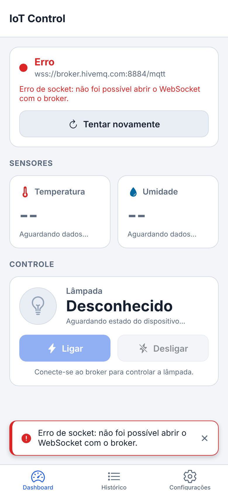
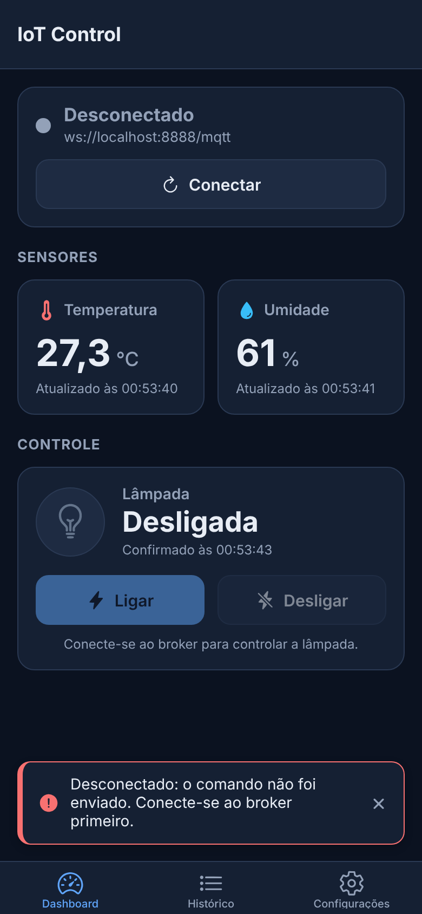

# IoT Control — Painel MQTT em React Native

Checkpoint 3 — Mobile Development & IoT (FIAP)

Aplicativo mobile em **React Native + Expo + TypeScript** que monitora e controla um ambiente inteligente simulado usando o protocolo **MQTT** (modelo publish/subscribe) sobre **WebSocket**. O app recebe em tempo real leituras de **temperatura** e **umidade**, envia comandos para uma **lâmpada virtual** e mostra o estado **confirmado pelo dispositivo**. Um script simulador incluído no repositório faz o papel do dispositivo IoT, então não é preciso hardware.

## Integrantes

| Nome completo | RM |
|---|---|
| _PREENCHER — Nome completo do integrante 1_ | _RM00000_ |
| _PREENCHER — Nome completo do integrante 2_ | _RM00000_ |
| _PREENCHER — Nome completo do integrante 3_ | _RM00000_ |

---

## Sumário

- [Funcionalidades](#funcionalidades)
- [Tecnologias e versões](#tecnologias-e-versões)
- [Instalação e execução](#instalação-e-execução)
- [Broker MQTT (WebSocket)](#broker-mqtt-websocket)
- [Tópicos e payloads](#tópicos-e-payloads)
- [Simulador do dispositivo](#simulador-do-dispositivo)
- [Roteiro de verificação (ciclo completo)](#roteiro-de-verificação-ciclo-completo)
- [Telas](#telas)
- [Arquitetura](#arquitetura)
- [Limitações e observações](#limitações-e-observações)

---

## Funcionalidades

### Conexão MQTT
- URL WebSocket do broker configurável (com atalhos para brokers públicos) e **validada** antes de conectar: URLs `mqtt://`/`tcp://` e as portas TCP **1883/8883** são recusadas com uma mensagem explicando o motivo.
- Botões **Salvar e conectar** e **Desconectar**.
- Status visível em todas as telas principais: **Conectando**, **Conectado**, **Desconectado** ou **Erro** (com a mensagem de erro traduzida).
- **Reconexão automática** com backoff exponencial (1s, 2s, 4s, 8s, 15s; até 5 tentativas) após queda inesperada, exibindo "Reconectando (tentativa N)". Se esgotar, ou se a primeira conexão falhar, aparece o botão **Tentar novamente**.
- Opção **Conectar ao abrir o app** (salva no AsyncStorage).

### Inscrição e recebimento
- Inscrição automática nos tópicos de temperatura, umidade e estado da lâmpada (e reinscrição a cada reconexão).
- A interface atualiza sozinha a cada mensagem, sem botão de atualizar, mostrando o último valor e o **horário da atualização**.
- **Validação dos payloads**: JSON inválido, campo ausente ou não numérico, valores fora da faixa (temperatura de -40 a 85 °C, umidade de 0 a 100 %) e estado diferente de `ON`/`OFF` são **ignorados sem quebrar o app**. A mensagem aparece no histórico marcada como "Ignorada" e com o motivo.

### Publicação de comandos
- Botões **Ligar** e **Desligar** publicam `{"action":"ON"}` / `{"action":"OFF"}` (QoS 1).
- **Sem publicação silenciosa**: se o app estiver desconectado, nada é publicado e aparece um aviso ("Desconectado: o comando não foi enviado…").
- O estado da lâmpada exibido vem **somente** da mensagem recebida no tópico de estado. Depois do toque, o botão mostra "Aguardando confirmação…". Se o dispositivo não responder em 5 s, o usuário é avisado.

### Histórico
- As **10 mensagens mais recentes**, enviadas e recebidas, com tópico, payload, horário, direção (ENVIADA/RECEBIDA) e marcação de mensagem retida ou inválida. Atualiza em tempo real e tem o botão **Limpar**.

### Preferências e tema
- **AsyncStorage** guarda a URL do broker, o tema e a opção de conexão automática. Tudo é recuperado quando o app reinicia.
- Temas **Light** e **Dark** em todas as telas, incluindo cabeçalho, barra de abas e status bar. Na primeira execução o app segue o tema do sistema.

---

## Tecnologias e versões

| Tecnologia | Versão |
|---|---|
| Expo SDK | 58 (`expo ~58.0.16`) |
| React Native | 0.88.0 |
| React | 19.3.0 |
| TypeScript | ~6.0.3 (modo `strict`) |
| Expo Router (navegação por abas) | ~58.0.24 |
| paho-mqtt (cliente MQTT via WebSocket no app) | 1.1.0 |
| @react-native-async-storage/async-storage | 2.2.0 |
| @expo/vector-icons | ^15.0.2 |
| mqtt (MQTT.js, usado **apenas no simulador** Node) | ^5.16.1 |
| Node.js (para rodar o projeto e o simulador) | 20 LTS ou superior (testado com 22) |

> Por que **paho-mqtt**? É JavaScript puro e usa o `WebSocket` nativo do ambiente. Por isso funciona no Android, no iOS e na Web, inclusive no **Expo Go**, sem polyfills nem módulos nativos.

---

## Instalação e execução

Pré-requisitos: Node.js 20+, npm e o app **Expo Go** no celular (ou um emulador Android / simulador iOS).

```bash
git clone <URL-DO-REPOSITORIO>
cd iot-control
npm install

# Inicia o Metro bundler (escaneie o QR code com o Expo Go)
npx expo start

# Atalhos
npm run android   # abre no emulador/dispositivo Android
npm run ios       # abre no simulador iOS (macOS)
npm run web       # abre no navegador
```

Em outro terminal, inicie o simulador do dispositivo:

```bash
npm run simulator
```

Scripts úteis:

| Script | Descrição |
|---|---|
| `npm start` | `expo start` |
| `npm run simulator` | Simulador do dispositivo IoT (Node) |
| `npm run typecheck` | Verificação de tipos (`tsc --noEmit`) |
| `npm run lint` | ESLint (`expo lint`) |

---

## Broker MQTT (WebSocket)

O app usa MQTT **sobre WebSocket**. Configuração padrão:

| Item | Valor |
|---|---|
| URL padrão | **`wss://broker.hivemq.com:8884/mqtt`** |
| Protocolo | WSS (WebSocket com TLS) |
| Host | `broker.hivemq.com` (broker público, sem autenticação) |
| Porta | **8884** (WebSocket seguro) |
| Caminho | `/mqtt` |

Alternativas também testáveis pela tela de Configurações:

| Broker | URL WebSocket |
|---|---|
| EMQX | `wss://broker.emqx.io:8084/mqtt` |
| Mosquitto | `wss://test.mosquitto.org:8081/mqtt` |
| Broker local (ex.: Mosquitto com listener websockets) | `ws://<IP-DO-COMPUTADOR>:<porta-ws>/mqtt` |

> ⚠️ **1883 não é porta WebSocket.** A 1883 (e a 8883) é a porta **MQTT TCP**, que só clientes nativos usam (o simulador Node pode usá-la, por exemplo). O app só conecta por `ws://` ou `wss://` na **porta WebSocket** do broker e recusa 1883/8883.

**Credenciais:** os brokers públicos acima não exigem usuário e senha. Nenhuma credencial fica no repositório. Se usar um broker privado com o simulador, informe as credenciais por variável de ambiente (`MQTT_USERNAME`, `MQTT_PASSWORD`), nunca no código.

---

## Tópicos e payloads

Prefixo exclusivo do grupo: **`fiap/cp3/iotcontrol-grupo01`**. Ele está definido em `src/config/mqttConfig.ts` (`TOPIC_BASE`) e, no simulador, como padrão de `MQTT_TOPIC_BASE`.

| Tópico | Direção no app | Quem publica | Payload | Retida? |
|---|---|---|---|---|
| `fiap/cp3/iotcontrol-grupo01/sensor/temperatura` | **Subscribe** (recebe) | Simulador | `{"value":24.5}` (°C, -40 a 85) | Sim |
| `fiap/cp3/iotcontrol-grupo01/sensor/umidade` | **Subscribe** (recebe) | Simulador | `{"value":58}` (%, 0 a 100) | Sim |
| `fiap/cp3/iotcontrol-grupo01/lampada/comando` | **Publish** (envia) | App | `{"action":"ON"}` ou `{"action":"OFF"}` | Não |
| `fiap/cp3/iotcontrol-grupo01/lampada/estado` | **Subscribe** (recebe) | Simulador (após cada comando) | `{"state":"ON"}` ou `{"state":"OFF"}` | Sim |

- QoS 1 em inscrições e publicações.
- O simulador publica sensores e estado como **mensagens retidas**, então o app mostra os últimos valores assim que se inscreve.
- O app também aceita um número puro (ex.: `24.5`) nos tópicos de sensor, para facilitar testes manuais.

---

## Simulador do dispositivo

Arquivo: `simulator/simulator.js` (Node.js + MQTT.js). O que ele faz:

1. Conecta ao broker (padrão: o mesmo do app) e se inscreve em `lampada/comando`.
2. Publica o estado inicial da lâmpada (`OFF`) e uma leitura de cada sensor.
3. A cada 5 s publica temperatura e umidade com variação aleatória realista.
4. Ao receber `{"action":"ON"|"OFF"}`, espera cerca de 400 ms (latência simulada) e publica `{"state":"ON"|"OFF"}` no tópico de estado.

```bash
npm run simulator                                  # padrão: HiveMQ WSS, sensores a cada 5 s
npm run simulator -- --interval 2                  # publica a cada 2 s
npm run simulator -- --manual                      # não publica sensores sozinho (só por comando)
npm run simulator -- --broker wss://broker.emqx.io:8084/mqtt
npm run simulator -- --broker mqtt://broker.hivemq.com:1883   # o simulador (Node) também aceita TCP
MQTT_TOPIC_BASE=fiap/outra/base npm run simulator  # outro prefixo (altere também no app)
```

Comandos que podem ser digitados no terminal do simulador:

| Comando | Ação |
|---|---|
| `t 27.3` | publica temperatura 27,3 °C |
| `h 61` | publica umidade 61 % |
| `on` / `off` | força o estado da lâmpada (sem comando do app) |
| `tick` | publica uma leitura aleatória de cada sensor |
| `invalid` | publica payloads inválidos (para testar a validação) |
| `pause` / `resume` | pausa/retoma a publicação automática |
| `help` / `quit` | ajuda / encerra |

### Alternativa sem o script (outro cliente MQTT)

Dá para simular o dispositivo com o **MQTT Explorer**, o **HiveMQ WebSocket Client** (`https://www.hivemq.com/demos/websocket-client/`) ou o `mosquitto_pub`/`mosquitto_sub`:

1. Conecte o cliente ao mesmo broker (ex.: `broker.hivemq.com`, porta WS 8884 com TLS, ou TCP 1883 em clientes nativos).
2. Inscreva-se em `fiap/cp3/iotcontrol-grupo01/lampada/comando`.
3. Publique `{"value":26.1}` em `.../sensor/temperatura` e `{"value":55}` em `.../sensor/umidade`.
4. Quando chegar `{"action":"ON"}`, publique `{"state":"ON"}` em `.../lampada/estado` (e o equivalente para `OFF`).

Com Mosquitto CLI:

```bash
mosquitto_sub -h broker.hivemq.com -p 1883 -t 'fiap/cp3/iotcontrol-grupo01/lampada/comando' -v
mosquitto_pub -h broker.hivemq.com -p 1883 -t 'fiap/cp3/iotcontrol-grupo01/sensor/temperatura' -m '{"value":26.1}'
mosquitto_pub -h broker.hivemq.com -p 1883 -t 'fiap/cp3/iotcontrol-grupo01/sensor/umidade' -m '{"value":55}'
mosquitto_pub -h broker.hivemq.com -p 1883 -t 'fiap/cp3/iotcontrol-grupo01/lampada/estado' -m '{"state":"ON"}' -r
```

---

## Roteiro de verificação (ciclo completo)

1. Rode `npx expo start` e abra o app. Ele conecta sozinho ao broker padrão e o status fica **Conectado**.
2. Rode `npm run simulator -- --manual`.
3. No terminal do simulador, digite `t 27.3`: o card **Temperatura** muda para 27,3 °C com o horário.
4. Digite `h 61`: o card **Umidade** muda para 61 %.
5. No app, toque em **Ligar**. O simulador mostra `↓ .../lampada/comando {"action":"ON"}` e publica `{"state":"ON"}`.
6. O app recebe o estado e mostra **Ligada** (ícone aceso e horário da confirmação).
7. Toque em **Desligar**: mesmo fluxo, e o app mostra **Desligada**.
8. Abra **Histórico**: estão lá as mensagens enviadas (roxo, ENVIADA) e recebidas (ciano, RECEBIDA). Digite `invalid` no simulador para ver mensagens rejeitadas pela validação.
9. Em **Configurações**, toque em **Desconectar** e depois em **Ligar** no Dashboard: aparece o aviso de que o comando não foi enviado.
10. Troque o tema para **Dark** e reinicie o app: tema e URL continuam como estavam.

Este roteiro foi automatizado durante o desenvolvimento (Playwright na versão Web, com broker local Aedes) e todos os passos passaram: recebimento de sensores, Ligar/Desligar confirmado pelo estado, aviso ao publicar desconectado, persistência após recarregar, reconexão automática depois de derrubar o broker e exatamente **uma** entrada no histórico por mensagem, ou seja, sem listeners duplicados.

---

## Telas

Prints da versão Web (viewport de celular) gerados no teste ponta a ponta, em `docs/screenshots/`.

| Dashboard (Light) | Histórico (Light) | Configurações (Light) |
|---|---|---|
|  |  |  |

| Dashboard (Dark) | Histórico (Dark) | Configurações (Dark) |
|---|---|---|
|  |  |  |

| Erro de conexão | Comando com o app desconectado |
|---|---|
|  |  |

- **Dashboard:** status da conexão (com o botão Tentar novamente em caso de erro), cards de temperatura e umidade com o horário da última leitura, e o card da lâmpada com o estado confirmado, o indicador de "aguardando confirmação" e os botões Ligar/Desligar.
- **Histórico:** as 10 últimas mensagens, das mais recentes para as mais antigas, com direção, tópico, payload, horário e marcação de retida/inválida.
- **Configurações:** URL do broker com validação e atalhos, Salvar e conectar / Desconectar, conexão automática, tema Light/Dark e a lista de tópicos usados.
- **Avisos:** um banner global mostra o resultado das ações (conectado, erro, comando enviado, sem confirmação, desconectado).

---

## Arquitetura

```text
src/
  app/                      # rotas do Expo Router (abas)
    _layout.tsx             # carrega preferências, providers, navegação por abas e tema da navegação
    index.tsx               # → DashboardScreen
    history.tsx             # → HistoryScreen
    settings.tsx            # → SettingsScreen
  components/
    AppButton.tsx           # botão com variantes, ícone, loading
    Card.tsx
    ConnectionStatus.tsx    # status + erro + tentar novamente
    LampControl.tsx         # estado confirmado + comandos
    MessageItem.tsx         # item do histórico
    NoticeBanner.tsx        # aviso global de feedback
    Screen.tsx              # container das telas
    SectionTitle.tsx
    SensorCard.tsx
  config/
    mqttConfig.ts           # prefixo do grupo, tópicos, broker padrão, timeouts
  contexts/
    MqttContext.tsx         # estado da aplicação: conexão, leituras, histórico, comandos
    ThemeContext.tsx        # tema Light/Dark persistido
  screens/
    DashboardScreen.tsx
    HistoryScreen.tsx
    SettingsScreen.tsx
  services/
    mqttService.ts          # TODA a comunicação MQTT (Paho), isolada da UI
    storageService.ts       # AsyncStorage (URL, tema, conexão automática)
  themes/
    colors.ts               # paletas light/dark tipadas
  types/
    mqtt.ts                 # tipos de status, payloads, leituras, histórico
  utils/
    validators.ts           # validação de payloads e da URL do broker
    format.ts               # formatação pt-BR de horário/números
simulator/
  simulator.js              # dispositivo IoT simulado (Node + MQTT.js)
```

**Fluxo de dados:** o `mqttService` (singleton) é o único lugar que conhece o Paho. Ele expõe `connect`, `disconnect`, `publish` e `subscribe(topics)`, além de `onStatusChange(listener)` e `onMessage(listener)`. **Todos** esses métodos de registro devolvem uma função de cancelamento. O `MqttProvider` registra os listeners dentro de `useEffect` e devolve essas funções no cleanup, então desmontar o componente (ou re-executar o efeito no StrictMode) remove inscrições e callbacks sem acumular eventos duplicados. Ao trocar de broker, o serviço também descarta o cliente anterior e ignora callbacks atrasados dele. A validação dos payloads acontece no provider, antes de atualizar o estado. As telas só consomem `useMqtt()` e `useTheme()`.

**TypeScript:** modo `strict`, sem `any`. Status, direção e estado da lâmpada usam uniões literais, as validações usam uniões discriminadas (`ValidationResult<T>`, `PublishResult`) e componentes e contextos têm props tipadas.

---

## Limitações e observações

- **Brokers públicos** (HiveMQ, EMQX, Mosquitto) são compartilhados, sem autenticação nem garantia de disponibilidade. Qualquer pessoa que conheça os tópicos pode ler ou publicar neles, e por isso o prefixo é exclusivo. Se um broker estiver fora do ar, troque nos atalhos da tela de Configurações e use o mesmo broker no simulador (`--broker`).
- Redes corporativas ou de faculdade podem bloquear WebSocket em portas não padrão (8884/8084/8081). Nesse caso, use os dados móveis ou outra rede.
- **Broker local:** em um dispositivo físico, `localhost` aponta para o próprio celular. Use o IP do computador na rede (ex.: `ws://192.168.0.10:9001/mqtt`) e habilite um listener `websockets` no broker. No Android, `ws://` (sem TLS) pode exigir configuração de cleartext; prefira `wss://`.
- O histórico fica **em memória** (é limpo quando o app fecha), como pede o enunciado. Só as preferências são persistidas.
- Com `cleanSession: true`, comandos enviados com o dispositivo offline não são enfileirados para ele. O app avisa quando não chega confirmação em 5 s.
- Os prints foram gerados na versão **Web**. Android e iOS usam o mesmo código e layout (React Native + Flexbox), e todas as dependências fazem parte do Expo SDK, o que permite rodar no **Expo Go** sem build nativo.
